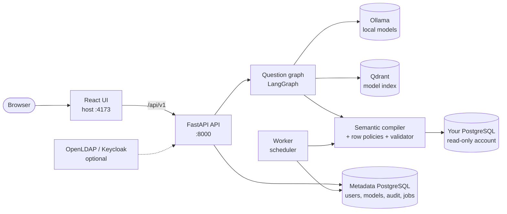

# Text-to-SQL Platform

A local-first Text-to-SQL platform for PostgreSQL. A user asks a question in plain language;
a local LLM (Ollama) writes logical SQL over a semantic model, a compiler turns it into
PostgreSQL SQL with row-level security applied, a validator checks it, and the rows come
back with a step timeline, charts and a summary. Everything runs on your own machine:
no data or prompts leave it. Only PostgreSQL is supported as a data source.

- [docs/RUNBOOK.md](docs/RUNBOOK.md): deploy, re-index, rotate keys, roles, LDAP and OIDC, schedules, DBA reset
- [docs/DEMO.md](docs/DEMO.md): a 10-minute demo script
- [docs/PROJECT.md](docs/PROJECT.md): what is built, as built
- [docs/KNOWN_ISSUES.md](docs/KNOWN_ISSUES.md) and [docs/EVALUATION.md](docs/EVALUATION.md): what does not work yet, and the accuracy numbers
- [docs/DECISIONS.md](docs/DECISIONS.md): why things are the way they are; [docs/openapi.yaml](docs/openapi.yaml): the API
  contract used to generate the UI types. The live Swagger UI is at <http://localhost:8000/docs>
  and its OpenAPI JSON is at <http://localhost:8000/openapi.json>.

## How it fits together



The code is hexagonal: `app/ports` defines the interfaces, `app/adapters` implements them
(Ollama, Qdrant, PostgreSQL, LDAP, OIDC), and `lint-imports` (part of `make check`) stops ports and the
core from importing adapters. Every question runs: retrieve model context, generate logical
SQL, compile under the asker's row policies, validate (allowlist plus `EXPLAIN`), execute
read-only. Nothing but a compiled, validated single `SELECT` ever reaches the database.

## Quick start

About 15 minutes once the model weights are downloaded (the download itself depends on your
connection; the default models are several GB).

### 1. Prerequisites

| Tool | Notes |
| --- | --- |
| Docker with Compose v2 (or Podman with the Docker CLI emulation) | runs PostgreSQL, Qdrant, Ollama, the API and the worker |
| `make` and `openssl` | the commands below; `openssl` generates your secrets |
| Node.js 22+ and npm | the web UI runs on the host with Vite |
| [`uv`](https://docs.astral.sh/uv/) | only for `make check` and local development |
| 16 GB RAM minimum | CPU only works but is slow (tens of seconds per answer). A GPU with 12-16 GB VRAM is the reference; see *GPU* below. Leave several GB of disk for the models |

Host ports: 8000 (API), 4173 (UI), 6333 (Qdrant), 55432 and 55433 (the metadata and demo
databases; change them with `API_HOST_PORT`, `QDRANT_HOST_PORT`, `METADATA_HOST_PORT` and
`DEMO_HOST_PORT`; point the UI at a moved API with `VITE_API_PROXY_TARGET`). Ollama is not published.

### 2. Configure, start, pull the models

```bash
make init-env     # creates .env with random secrets and prints the first DBA password
make up           # builds and starts the stack, then applies the database migrations
make models       # pulls the models named in .env (the Ollama volume starts empty)
make bootstrap    # creates the first DBA account and clears the temporary password from .env
curl http://localhost:8000/health/ready   # {"status":"ok", ...}
```

`.env` is ignored by git; never commit it. Passwords for the DBA account are temporary: you
must change it at first sign-in. The Compose network is internal, so containers cannot reach
the internet.

`SQL_MODEL` (default `llama3:latest`) writes the SQL, `EMBEDDING_MODEL` (default
`nomic-embed-text:latest`) powers retrieval, and the optional `SMALL_MODEL` handles routing
steps and falls back to `SQL_MODEL`. If you change them in `.env`, run `make models` again.
Do not use a model whose name ends in `-cloud`: it sends inference to an external service.

### 3. Start the UI

```bash
cd ui && npm ci && npm run generate:api && npm run dev
```

Open <http://127.0.0.1:4173> and sign in as `demo.dba` with the password `make init-env`
printed (it is also `BOOTSTRAP_DBA_PASSWORD` in `.env` until `make bootstrap` clears it).

### 4. First answered question, as a DBA

1. **Setup** > **PostgreSQL** card. For the bundled sample data use host `demo-db`, port `5432`,
   database `demo`, user `warehouse_reader` and `WAREHOUSE_READER_PASSWORD` from `.env`.
2. **Test connection**, create the project, **select tables**, define relationships, then
   **Validate and save model**.
   On the Review step, **Browse live database rows** shows exact counts for the current table
   page. **Preview rows** opens up to 50 read-only rows with column names and PostgreSQL types;
   the dialog also shows the exact total. This requires `manage_connection`.
3. **Connect and model** > **Deploy report** > **Deploy model**.
4. **Home**: ask "How many customers do we have?".

**Shortcut without clicking through Setup** (verified on a clean clone): the API can create the
bundled E-commerce sample project and deploy it in two calls.

```bash
API=http://localhost:8000/api/v1
TOKEN=$(curl -s $API/auth/login -H 'content-type: application/json' \
  -d '{"username":"demo.dba","password":"<your new password>"}' | python3 -c 'import sys,json;print(json.load(sys.stdin)["access_token"])')
PROJECT=$(curl -s -X POST $API/sample-projects/ecommerce -H "authorization: Bearer $TOKEN" \
  | python3 -c 'import sys,json;print(json.load(sys.stdin)["id"])')
curl -s -X POST $API/projects/$PROJECT/deploy -H "authorization: Bearer $TOKEN"        # indexes the model
curl -s $API/projects/$PROJECT/query -H "authorization: Bearer $TOKEN" -H 'content-type: application/json' \
  -d '{"question":"How many customers do we have?"}'
```

The project then appears in the UI. Change the temporary password first (the UI asks you to at
first sign-in); the first answer takes from several seconds on a GPU to about two minutes on a CPU.

### 5. First answered question, as a user

As the DBA, open **Users and roles**, create an account with the **User** role and give it
access to the project (or `make user-create USERNAME=maria ROLE=User`, which asks for a temporary password and then needs the project access granted in the UI). Sign in as that
account: the menu shows only Home and Shared with me, and answers respect row policies.

### GPU

The base Compose file runs the models on the CPU. With an NVIDIA GPU and the
[NVIDIA Container Toolkit](https://docs.nvidia.com/datacenter/cloud-native/container-toolkit)
installed, add the overlay: `make up GPU=1`. Other GPUs are not configured.

### Other commands

| Command | What it does |
| --- | --- |
| `make down` / `make logs` | stop the stack / follow the api and worker logs |
| `make user-create USERNAME=x ROLE=User` | add a local account |
| `make up IDENTITY=1` | also start OpenLDAP and Keycloak (see the runbook for the secrets they need) |
| `make check` | ruff, mypy, import-linter and the Python tests |
| `make audit` | known-vulnerability scan of the locked Python and UI dependencies |
| `make secrets` | scan for committed secrets (needs the `gitleaks` binary) |
| `make e2e` | Playwright tests against the UI mock API |
| `make offline` | the whole stack with outbound traffic blocked |
| `make eval PROJECT_ID=... USERNAME=...` | execution accuracy on the golden set, then the accuracy gate |

## External PostgreSQL sample databases

These projects publish sample data or SQL scripts that you can download and restore into
a PostgreSQL server for additional testing. They are datasets, not guaranteed public
database endpoints:

| Sample database | Example data | Source and compatibility |
| --- | --- | --- |
| Chinook | Digital media store: artists, albums, tracks, invoices, and customers | [Project and downloads](https://github.com/lerocha/chinook-database); choose its PostgreSQL SQL script. |
| AdventureWorks for PostgreSQL | Larger business schema with HR, sales, products, and purchasing | [Project scripts](https://github.com/lorint/AdventureWorks-for-Postgres). |
| Pagila | DVD rental store with films, customers, inventory, rentals, and payments | [Project and scripts](https://github.com/devrimgunduz/pagila). The current release documents PostgreSQL 18+; this project’s Compose databases use PostgreSQL 16, so check the selected Pagila release’s requirements before restoring it. |
| Airlines Demo Database | Airline, airport, and flight sample data | [Download and setup information](https://postgrespro.com/education/demodb). |

For a first external dataset, Chinook is a small, straightforward SQL-script option.
AdventureWorks is a closer match when you want broader business data. The local Compose
demo already includes `customers`, `products`, `orders`, and `inventory`, so an external
dataset is optional.

Restore downloaded data into a local PostgreSQL server and connect with a read-only
database account. Do not expose a database to the internet for this test. To connect a
different server through the Compose API, add only its intended hostname or IP address
to `DB_HOST_ALLOWLIST` in `.env`; the application rejects hosts not on that allowlist.

## Connecting your own PostgreSQL database

The API runs inside Docker, so the host you type in **Setup** is resolved from inside the
API container, not from your machine:

- `localhost` means the API container itself, not your computer.
- The Compose network (`<project>_local`, for example `texttosql_local`) is internal: it has
  no route to your host or the internet. Put the database on that network and use its
  container name as the host, for example:
  ```bash
  docker run -d --name my-pg --network texttosql_local \
    -e POSTGRES_PASSWORD=admin_pw -e POSTGRES_DB=mydb docker.io/library/postgres:16
  ```
  (`docker network ls` shows the exact network name on your machine.)
- Add the host to `DB_HOST_ALLOWLIST` in `.env` (comma separated, no spaces; a name, an IP
  or a CIDR range) and recreate the API so it picks the change up:
  ```bash
  docker compose --env-file .env up -d --force-recreate api
  docker compose --env-file .env exec api env | grep DB_HOST_ALLOWLIST
  ```
- Connect with a read-only account that can only `SELECT` the schemas you want exposed:
  ```sql
  CREATE ROLE app_reader LOGIN PASSWORD '...';
  GRANT CONNECT ON DATABASE mydb TO app_reader;
  GRANT USAGE ON SCHEMA public TO app_reader;
  GRANT SELECT ON ALL TABLES IN SCHEMA public TO app_reader;
  ```
- The app is local-only. Do not expose a database to the internet for testing.

## Troubleshooting

| Symptom | Likely cause and fix |
| --- | --- |
| "Database host is not in DB_HOST_ALLOWLIST" | The host is missing from `DB_HOST_ALLOWLIST`, or the API was not recreated after editing `.env`. A `DB_HOST_ALLOWLIST` exported in your shell overrides `.env`: run `unset DB_HOST_ALLOWLIST`, recreate the API, then check with the `env \| grep` command above. |
| "Could not read database catalog" in Setup | The connected database is unreachable. Check that its container is running (`docker ps -a`), is on the Compose network, and that the host, port and read-only password are right. Containers do not restart on their own after a reboot unless created with `--restart unless-stopped`. |
| Connection test fails with a name error | The host is not resolvable from the API container. Use the container name on the Compose network, not `localhost`. |
| `docker compose` complains about `METADATA_ADMIN_PASSWORD` or similar | `.env` is missing or a required password is unset. Copy `.env.example` and fill it in. |
| The API refuses to start (secrets) | `JWT_SECRET` (32+ characters) or `CONNECTION_ENCRYPTION_KEY` (a Fernet key) is missing or invalid. |
| Questions fail with "LLM unavailable" | The Ollama models are not pulled yet, or `SQL_MODEL` / `EMBEDDING_MODEL` name a model you did not pull. |
| Home answers "No relevant models" or never returns rows | The model was saved but not deployed. Deploy it from **Connect and model**. |
| The API container shows `unhealthy` | The healthcheck calls `/health`; check `docker compose logs api` and `curl localhost:8000/health/ready` (it names the dependency that is down). Compose files before v0.1.0 used a healthcheck that Podman split at spaces and always failed. |
| Port already in use | Another service holds 8000, 4173, 6333, 55432 or 55433. Stop it or change the port. |
| Using Podman | The Docker CLI emulation works, but commands may print an emulation notice. Create `/etc/containers/nodocker` to silence it. |

## Checks

```bash
make check
cd ui
npm ci
npm run generate:api
npm run test
npm run build
npm run test:e2e
```

Live database permission tests run in the Compose test service after migrations:

```bash
cd ..
docker compose --env-file .env --profile test run --rm tests
```

The API and worker containers are on the internal Compose network. After the stack is
running, the Day 1 outbound-connectivity check is:

```bash
./scripts/test-egress.sh
```

## Troubleshooting

| Symptom | Likely cause and fix |
| --- | --- |
| "Database host is not in DB_HOST_ALLOWLIST" | The host is missing from `DB_HOST_ALLOWLIST`, or the API was not recreated after editing `.env`. A `DB_HOST_ALLOWLIST` exported in your shell overrides `.env`: run `unset DB_HOST_ALLOWLIST`, recreate the API, then check with the `env \| grep` command above. |
| "Could not read database catalog" in Setup | The connected database is unreachable. Check that its container is running (`docker ps -a`), is on the Compose network, and that the host, port and read-only password are right. Containers do not restart on their own after a reboot unless created with `--restart unless-stopped`. |
| Connection test fails with a name error | The host is not resolvable from the API container. Use the container name on the Compose network, not `localhost`. |
| `docker compose` complains about `METADATA_ADMIN_PASSWORD` or similar | `.env` is missing or a required password is unset. Copy `.env.example` and fill it in. |
| The API refuses to start (secrets) | `JWT_SECRET` (32+ characters) or `CONNECTION_ENCRYPTION_KEY` (a Fernet key) is missing or invalid. |
| Questions fail with "LLM unavailable" | The Ollama models are not pulled yet, or `SQL_MODEL` / `EMBEDDING_MODEL` name a model you did not pull. |
| Home answers "No relevant models" or never returns rows | The model was saved but not deployed. Deploy it from **Connect and model**. |
| The API container shows `unhealthy` | The healthcheck calls `/health`; check `docker compose logs api` and `curl localhost:8000/health/ready` (it names the dependency that is down). Compose files before v0.1.0 used a healthcheck that Podman split at spaces and always failed. |
| Port already in use | Another service holds 8000, 4173, 6333, 55432 or 55433. Stop it or change the port. |
| Using Podman | The Docker CLI emulation works, but commands may print an emulation notice. Create `/etc/containers/nodocker` to silence it. |

## Checks

```bash
make check
cd ui && npm ci && npm run generate:api && npm run test && npm run build && npm run test:e2e
docker compose --env-file .env --profile test run --rm tests   # live database and permission tests
make offline                                                   # needs OIDC_CLIENT_SECRET and KEYCLOAK_ADMIN_PASSWORD
```

`npm run dev:mock` runs the UI against labelled fixtures instead of the real API; the mock
account and data are not real authentication or database access.
