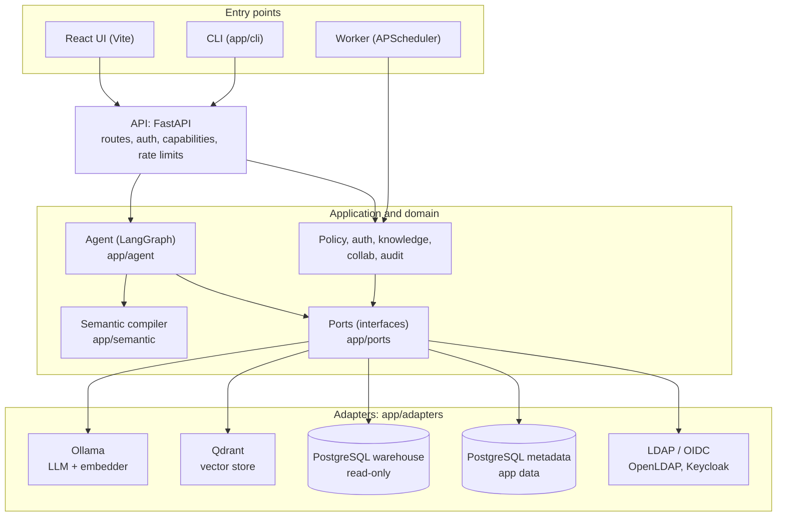
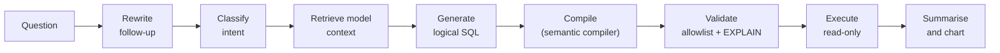

# Architecture

The Text-to-SQL platform is a local-only service. It turns a natural-language question into a
validated, read-only SQL query against a PostgreSQL warehouse. It uses a **hexagonal (ports and
adapters)** design: business logic depends on interfaces, and infrastructure plugs in behind them.

For the full as-built description see [PROJECT.md](PROJECT.md). For the reasoning behind choices
see [DECISIONS.md](DECISIONS.md).

## Overview

## Layers

| Layer | Location | Responsibility |
| --- | --- | --- |
| Entry points | `ui/`, `app/cli`, `app/worker` | Users, operators and scheduled jobs |
| API | `app/api` | HTTP routes, authentication, capability checks, rate limiting |
| Application | `app/agent`, `app/semantic`, `app/policy`, `app/auth`, `app/knowledge`, `app/collab`, `app/audit` | Question pipeline, semantic compiler, governance and collaboration |
| Core and domain | `app/core`, `app/domain` | Pure logic and types, with no infrastructure imports |
| Ports | `app/ports` | Interfaces: LLM, embedder, vector store, warehouse, catalog, directory/identity, metadata repositories, audit, scheduler, cache |
| Adapters | `app/adapters` | Implementations: Ollama, Qdrant, PostgreSQL (warehouse and metadata), LDAP, OIDC |

## Dependency rules

`make check` runs import-linter, which enforces these contracts
(see [pyproject.toml](../pyproject.toml)):

- Ports never import adapters.
- `app.core` never imports ports, adapters or the API.

## How a question flows

1. **Rewrite and classify.** Follow-ups are made standalone. The intent is a data question, a clarification or chat.
2. **Retrieve.** Hybrid search finds relevant models, expands relationships and prunes columns.
3. **Generate.** The LLM produces structured logical SQL, with one repair retry.
4. **Compile.** `app/semantic/compiler.py` builds model CTEs, calculated fields and metrics. It checks joins against declared relationships and applies row-level security policies as bound parameters.
5. **Validate.** The query is checked against an allowlist and `EXPLAIN`.
6. **Execute.** The query runs read-only with a statement timeout.
7. **Present.** The result is summarised and charted.

The agent makes up to three typed corrections. Every failure is a typed, structured error.
**Only a compiled, validated, single `SELECT` ever reaches the database.**

## Runtime processes

| Process | Role |
| --- | --- |
| `api` | FastAPI service (`app/main.py`) |
| `worker` | Scheduler loop (`app/worker`) |
| UI | React app, run on the host with Vite |
| PostgreSQL (metadata) | Users, roles, projects, model revisions, policies, audit, threads and so on |
| PostgreSQL (demo data) | Sample warehouse (`ecommerce` and `human_resources` schemas) |
| Qdrant | Vector index, one collection filtered by project and model version |
| Ollama | Local LLM and embeddings |
| OpenLDAP, Keycloak | Optional identity providers, enabled with `IDENTITY=1` |

## Key properties

- **Local only.** There are no external calls, and the Compose network is internal.
- **Read-only data access.** The app connects to the warehouse through a read-only account.
- **Compiler-enforced security.** Row-level security is applied by the semantic compiler before the database is reached.
- **Swappable infrastructure.** Adapters sit behind ports, so a backend can be replaced without touching core logic.
